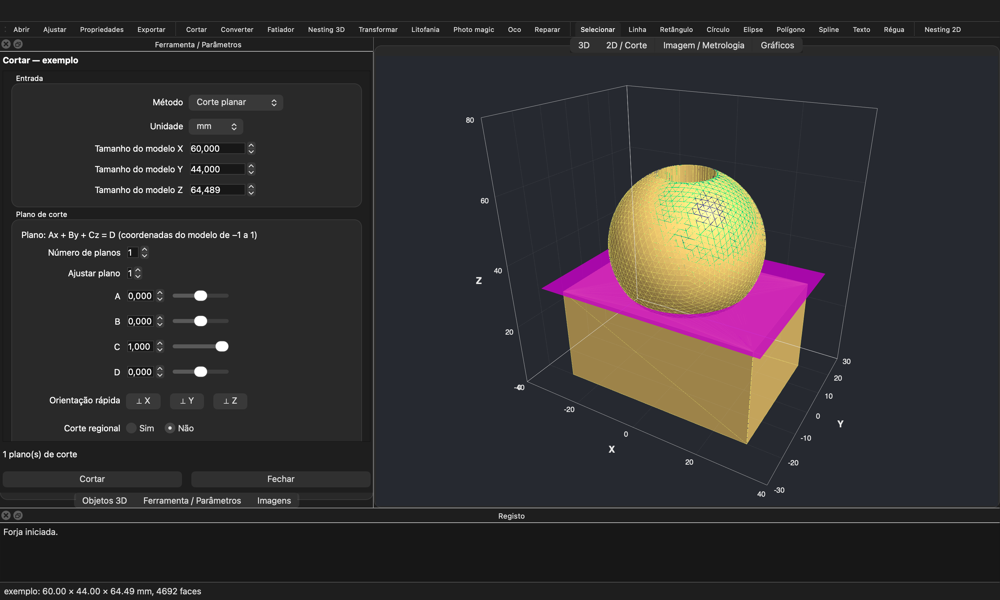

# Forja

**Forja** é uma aplicação de secretária (macOS, Windows, Linux) para preparar modelos para **impressão 3D** e **corte laser/CNC**, processar **imagens** e fazer **metrologia ótica**, tudo num só programa e com a interface em português.

A Forja é uma implementação própria, escrita de raiz em Python.



---

## Índice

- [Destaques](#destaques)
- [Transferir (pronto a usar)](#transferir-pronto-a-usar)
- [Instalação a partir do código](#instalação-a-partir-do-código)
- [Como se usa](#como-se-usa)
- [Menus e funções](#menus-e-funções)
- [Formatos de ficheiro](#formatos-de-ficheiro)
- [Estrutura do código](#estrutura-do-código)
- [Arquitetura](#arquitetura)
- [Línguas](#línguas)
- [Documentação](#documentação)
- [Estado e limitações](#estado-e-limitações)

---

## Destaques

- **Cortar modelos** num painel lateral: 9 métodos (planar com vários planos, cónico, flexível, grelha, grelha desfasada, radial, modular pelo tamanho da impressora…). Os planos de corte são visíveis e ajustáveis, há conectores (pinos e cavilhas) com espaçamento mínimo garantido e pré-visualização. **Depois de cortar, as definições continuam disponíveis**: ao selecionar uma peça, o painel reabre e o novo corte substitui o anterior.
- **Converter**: 26 conversões do modelo. Na impressão 3D: Block, Clicker, Cocoon, Grid, Helix, Mold, Pipe, Relief, Revolving, Slide, Spinner, Spring, Thermal, Tiling, Tumbler, Wave e Wireframe. Na chapa: Stack, Hash, Star, Grill, Contour, Plate e Folding, com as peças já encaixadas em chapas.
- **Litofanias** com 18 formas: plana, arco, CMYK, dupla, retângulo, polígono, tronco de cone, cilindro, cone, vaso, esfera, espiral, stencil, balão, caixa, bronze, tatuagem e azulejo.
- **Photo magic**: 25 maneiras de transformar uma fotografia ou um texto num objeto 3D (balão, caixa, célula, canal, clicker, cortador, extrusão, camadas, lenticular, apito…).
- **Objetos paramétricos**: garrafa com rosca helicoidal, hélice de bambu, dado, óculos com charneiras, planador e projeções de sombra. Há ainda dezenas de geradores (caixas, vasos, molas, moldes, puzzles, porta-chaves, cortadores de bolachas, carimbos…).
- **Fatiador FDM** com G-code: paredes, topo e fundo, enchimento (linhas, cruz, triângulos, quadrados, hexágonos), costura Z, aderência, suportes e retração.
- **Nesting 2D e 3D**: encaixar peças em chapas ou arrumá-las em caixas.
- **Desenho 2D e CAM**: tela vetorial, booleanas, offset, padrões de recorte, meio-tom vetorial, percursos de ferramenta, compensação do kerf, pontes, entradas e saídas, G-code, DXF, SVG e EPS.
- **Processamento de imagem**: mais de 100 operações (filtros, morfologia, FFT, Hough, watershed, alinhamento, panoramas…), aplicáveis em lote.
- **Metrologia ótica**: luz estruturada (franjas, código de Gray, desembrulhamento de fase), deflectometria, profundidade por foco, coerência de luz branca, DIC (correlação digital de imagem), shearografia, holografia digital, linha laser, estéreo, visual hull e nuvens de pontos (ICP, Delaunay).
- **CT e volumes**: Radon, retroprojeção filtrada, SART, feixe cónico (FDK), isosuperfícies e voxelização.
- **Visão por computador**: rostos, marcadores ArUco, códigos QR, alvos de calibração, foco total e segmentação por cor.
- **Dispositivos**: câmara em direto, projetor, porta série e varrimentos automáticos em mesa rotativa ou linear.
- **Aspeto da vista 3D**: superfície, arestas e pontos com escalas de cor, marcadores, tipos de linha, eixos em caixa, barra de cores, legenda e iluminação.
- **Projetos `.forja`** que guardam objetos, imagens, desenhos, aspeto e as definições das ferramentas. Podem ser cifrados com palavra-passe (AES/Fernet com PBKDF2).
- **Figuras `.fgs`**: lê e grava pastas `.fgs` + STL, com nomes, cores e aspeto das peças.

## Transferir (pronto a usar)

As versões compiladas estão na página **[Releases](https://github.com/NunoFilipePereira/Forja/releases/latest)**. Não é preciso instalar o Python.

| Sistema | Ficheiro | Como instalar |
|---|---|---|
| **Windows 10/11 (64 bits)** | `Forja-…-Windows-instalador.exe` | Execute o instalador. Cria atalhos no menu Iniciar e, se quiser, no ambiente de trabalho. |
| Windows (sem instalar) | `Forja-…-Windows-portatil.zip` | Descomprima e abra `Forja.exe`. |
| **Mac com Apple Silicon (M1–M4)** | `Forja-…-macOS-AppleSilicon.dmg` | Abra o `.dmg` e arraste a Forja para Aplicações. |
| Mac com processador Intel | `Forja-…-macOS-Intel.dmg` | Igual ao anterior. |

As versões ainda não estão assinadas digitalmente, por isso o sistema avisa na primeira vez:

- **macOS:** clique com o botão direito em Forja ▸ **Abrir** ▸ **Abrir**. Em alternativa, use Definições do Sistema ▸ Privacidade e Segurança ▸ **Abrir mesmo assim**.
- **Windows:** no aviso do SmartScreen, clique em **Mais informações** ▸ **Executar mesmo assim**.

Na versão instalada, o registo de erros fica em `~/.forja/erros.log`.

## Instalação a partir do código

Requisitos: **Python 3.12 ou mais recente** (testado com 3.12 e 3.14) e uma placa gráfica com OpenGL.

### macOS: duplo clique

Faça duplo clique em **`Forja.command`**. Na primeira vez cria o ambiente Python (`.venv`) e instala as dependências, o que demora alguns minutos. Nas vezes seguintes abre logo.

### Pela linha de comandos

```bash
git clone https://github.com/NunoFilipePereira/Forja.git
cd Forja
python3 -m venv .venv
.venv/bin/pip install -r requirements.txt
.venv/bin/python -m forja
```

Também se pode abrir ficheiros logo no arranque:

```bash
.venv/bin/python -m forja modelo.stl foto.png
```

No Windows, use `.venv\Scripts\python -m forja`.

### Dependências principais

| Pacote | Para quê |
|---|---|
| PySide6 | Interface (Qt 6) |
| pyqtgraph, PyOpenGL | Vista 3D em OpenGL |
| trimesh, manifold3d | Malhas 3D e operações booleanas robustas |
| shapely, rtree, networkx | Geometria 2D, nesting, percursos |
| numpy, scipy, scikit-image | Cálculo numérico, volumes, marching cubes |
| opencv-python-headless | Processamento de imagem e visão |
| matplotlib | Gráficos |
| ezdxf, svgpathtools | DXF e SVG |
| fast-simplification | Simplificação de malhas |
| pydicom | Fatias DICOM |
| pyserial | Dispositivos por porta série |
| cryptography | Projetos com palavra-passe |

### Compilar as versões para Windows e macOS

As versões são compiladas com [PyInstaller](https://pyinstaller.org). A configuração está em `packaging/`.

```bash
.venv/bin/pip install pyinstaller
.venv/bin/pyinstaller packaging/forja.spec --noconfirm
```

O resultado fica em `dist/`: `Forja.app` no macOS e a pasta `Forja/` com `Forja.exe` no Windows. Cada sistema só compila a sua própria versão. O instalador do Windows é gerado pelo [Inno Setup](https://jrsoftware.org/isinfo.php) a partir de `packaging/forja.iss`.

No GitHub, o processo `.github/workflows/build.yml` compila automaticamente para Windows, Mac Apple Silicon e Mac Intel. Quando se envia uma etiqueta de versão, publica tudo numa Release:

```bash
git tag v1.0.0
```

```bash
git push origin v1.0.0
```

## Como se usa

**Vista 3D**

| Ação | Como |
|---|---|
| Rodar | Arrastar com o botão esquerdo |
| Deslocar | Botão do meio ou ⌘+arrastar |
| Zoom | Roda do rato ou dois dedos |
| Ajustar à janela | ⌘0 |
| Mudar o que o arrasto faz | Ver ▸ Modo do rato (rodar, deslocar, arrastar objetos, mover a luz) |

**Objetos 3D:** é a lista de objetos.
- Shift ou ⌘ seleciona vários.
- A caixa ao lado de cada objeto liga e desliga a visibilidade.
- Duplo clique abre as propriedades.

**Painel de ferramenta** (à esquerda):
- Cortar, Converter, Litofania, Photo magic, Transformar, Fatiador e as outras ferramentas abrem aqui, com pré-visualização ao vivo.
- Depois de aplicar, o painel continua aberto. **Gravar de novo (substituir)** troca o resultado anterior.
- Selecionar uma peça criada por uma ferramenta reabre-a com os valores usados.

**Tela 2D:**
- Polígono, polilinha e spline: um clique por ponto; duplo clique ou Enter para terminar.
- Alt desliga o ajuste à grelha e Delete apaga.

**Imagens:** a ordem da lista (arrastável) define as imagens A, B, C… das operações com várias imagens.

**Erros:** ficam no painel Registo e no ficheiro `erros.log`.

### Fluxos típicos

| Objetivo | Passos |
|---|---|
| Modelo grande para imprimir | Abrir STL → Malha ▸ Cortar (ou Partição em grelha) → Ficheiro ▸ Exportar ▸ Cada objeto |
| Poupar material | Malha ▸ Oco |
| Imprimir | Malha ▸ Fatiador → G-code |
| Corte laser em camadas | Malha ▸ Fatiar em camadas → Desenho 2D ▸ Nesting → Percurso → G-code ou DXF |
| Caixa em MDF ou acrílico | Chapa ▸ Caixa com juntas em dente → Percurso → G-code ou DXF |
| Candeeiro | Criar ▸ Litofania (cilindro) ou Gerar ▸ Fotografia ▸ Litofania cilíndrica + Base de candeeiro |
| Digitalização 3D | Metrologia ▸ Gerar padrões → fotografar → Fase embrulhada → Desembrulhar → Fase → altura → Criar ▸ Mapa de profundidade → 3D |
| Com projetor e câmara | Dispositivos ▸ Aquisição automática de franjas |
| Ensaio de deformação | Metrologia ▸ DIC (antes/depois) → Deformações |
| Tomografia | CT / Volume ▸ Projeções → volume → Isosuperfície → objeto 3D |

## Menus e funções

São 20 menus com cerca de 640 entradas. A descrição completa de cada entrada está no guia em PDF **[docs/Forja_menus.pdf](docs/Forja_menus.pdf)**.

| Menu | O que tem |
|---|---|
| **Ficheiro** | Abrir, importar (malhas, imagens, imagens brutas, DXF/SVG, histogramas, curvas, nuvens de pontos), exportar, exemplos, juntar ficheiros, recetor de dados por rede, palavra-passe, figuras `.fgs` |
| **Editar** | Desfazer, duplicar, apagar, selecionar tudo, cor, nome |
| **Ver** | Vistas padrão, modos de exibição, ortográfica/perspetiva, luz, régua 3D, vista em corte, viewport, modo do rato, tema, unidades |
| **Criar** | Primitivas, texto 3D, relevo, litofanias (18 formas), Photo magic (25), projeção de sombras, garrafa, hélice, dado, óculos, planador |
| **Transformar** | Mover, rodar, escalar, espelhar, alinhar, pousar, assentar, organizar, vista explodida, juntar, embutir |
| **Malha** | Cortar, Converter, Fatiador, Nesting 3D, oco, reparar, simplificar, booleanas, separar, gravar texto, fatiar em camadas, cortes avançados, relevo projetado |
| **Desenho 2D** | Ferramentas de desenho, edição, booleanas, matrizes, nesting, percursos, G-code, padrões, meio-tom, vetorização |
| **Imagem** | Limiar, filtros, morfologia, arestas, contornos, Hough, FFT, análise, cor e geometria, máscaras, navegação |
| **Metrologia** | Franjas, fase, deflectometria, foco, speckle, visual hull, calibração, DIC, interferometria, holografia, linha laser, estéreo, nuvens de pontos |
| **Medir** | Propriedades, relatórios, distâncias, caixa mínima, verificações e estimativas da impressora |
| **Lote** | Pastas de imagens, vídeo, estatística do lote, colagens, panoramas, painel Lote para folhear ficheiros |
| **Ajuste** | Planos, polinómios, círculos, elipses, esferas, cilindros, curvatura, isolinhas |
| **Gerar** | Prismas, revoluções, caixas, vasos, molas, cavilhas, litofanias curvas, puzzles, moldes, low poly, suportes, acessórios |
| **Chapa** | Caixas com juntas em dente, planificação de cones, esculturas em fatias, divisão de formas, kerf, pontes, tempo de máquina |
| **CT / Volume** | Radon, FBP, SART, FDK, abrir e gravar volumes, isosuperfícies, voxelização, vista 3D do volume |
| **Visão** | Rostos, ArUco, QR, alvos de referência, foco total, movimento, segmentação, efeitos |
| **Dispositivos** | Câmara, projetor, aquisição automática, porta série, mesas rotativa e linear |
| **Gráficos** | Séries de dados, perfis, histogramas, dispersão, eixos, exportar figura |
| **Aspeto** | Superfície, arestas e pontos com escalas de cor, marcadores, linhas, amostragem, transparência, barra de cores, legenda, luz, textura, eixos |
| **Ajuda** | Atalhos, formato de dados, língua |

## Formatos de ficheiro

| Tipo | Ler | Gravar |
|---|---|---|
| Malhas 3D | STL, OBJ, PLY, OFF, 3MF, GLB | STL, OBJ, PLY, 3MF, GLB |
| Imagens | PNG, JPEG, BMP, TIFF (8/16 bits), GIF, dados brutos, DICOM | PNG, JPEG, BMP, TIFF, ICO, XPM |
| Vídeo | Frames de vídeo | Vídeo a partir de imagens |
| 2D | DXF, SVG, dados de texto | DXF, SVG, EPS, G-code |
| Volumes | Pastas de fatias, `.im3`, DICOM | `.im3`, fatias |
| Nuvens | TXT, XYZ, PLY | PLY, TXT (pontos e normais) |
| Gráficos | Colunas ASCII, `.fgs` | PNG, SVG, PDF, `.fgs` |
| Projetos | `.forja` (com ou sem palavra-passe), figuras (`.fgs` + STL) | `.forja`, figuras (`.fgs` + STL) |
| Impressão | — | G-code |

## Estrutura do código

O código tem cerca de 21 500 linhas de Python. As operações de cálculo ficam em `core/` e não dependem da interface; a interface fica em `ui/`.

```
Forja/
├── Forja.command          # arranque no macOS a partir do código (cria o .venv na primeira vez)
├── packaging/             # compilação: PyInstaller (forja.spec), instalador Windows (forja.iss), ícones
├── .github/workflows/     # compilação automática para Windows e macOS
├── requirements.txt
├── docs/
│   ├── Forja_menus.pdf    # guia de todos os menus
│   └── img/               # capturas de ecrã
└── forja/
    ├── __main__.py        # ponto de entrada (python -m forja), registo de erros
    ├── i18n.py            # traduções
    ├── lang/              # ficheiros de tradução (.tsv)
    ├── data/              # modelo de deteção de rostos (YuNet, OpenCV Zoo)
    ├── core/              # cálculo, sem interface
    └── ui/                # interface Qt
```

### `forja/core`: cálculo

| Módulo | Conteúdo |
|---|---|
| `meshops.py` | Operações de malha: primitivas, booleanas (manifold3d), oco, inflar, reparar, simplificar, suavizar |
| `mesh2.py` | Vista explodida, virar/juntar, caixa mínima, cortes radiais/modulares/naturais/desfasados, encaixes, relevo projetado, mapa de altura |
| `cutting.py` | Cortar: planar, cónico, flexível, grelha, radial, modular, com conectores |
| `conv3d.py` | Conversões para impressão 3D (Block, Clicker, Cocoon, Grid, Helix, Mold, Spring, Wireframe…) |
| `conv_sheet.py` | Conversões para chapa (Stack, Hash, Star, Grill, Contour, Plate, Folding) |
| `lithoshapes.py`, `litho.py` | Litofanias (18 formas) e litofanias completas com moldura, texto e pé |
| `photomagic.py` | Photo magic: 25 métodos foto → 3D |
| `create3d.py` | Projeção de sombras, garrafa, hélice de bambu, dado, óculos, planador |
| `cimg.py` | Utilitários comuns às ferramentas Criar (imagens, silhuetas, texto, quantização) |
| `generators.py`, `params.py` | Geradores paramétricos, com valores guardados para ajustar depois |
| `text3d.py` | Texto → contornos → sólido |
| `slicer.py` | Fatiador FDM e G-code |
| `nesting.py`, `nesting3d.py` | Nesting 2D (bottom-left com rotações) e 3D (caixas) |
| `shapes2d.py`, `draw2.py` | Formas 2D, DXF/SVG, padrões, meio-tom, foto → vetor |
| `sheet.py`, `toolpath.py` | Corte em chapa, percursos de ferramenta, G-code de laser/CNC |
| `imageops.py`, `imageops2.py`, `imageops3.py` | Processamento de imagem e visual hull |
| `fringe.py`, `metro2.py`, `metro3.py` | Metrologia: fase, DIC, holografia, estéreo, linha laser, nuvens, FDK |
| `fitting.py` | Ajuste de formas geométricas e curvatura |
| `ct.py` | Tomografia e volumes |
| `vision.py` | Visão por computador |
| `devices.py` | Porta série e câmara |
| `colormaps.py` | Escalas de cor, marcadores e tipos de linha da vista 3D |
| `fgs.py` | Leitura e escrita de figuras `.fgs` |
| `projcrypt.py` | Cifra de projetos com palavra-passe |
| `document.py` | Documento: lista de objetos 3D |

### `forja/ui`: interface

| Módulo | Conteúdo |
|---|---|
| `mainwindow.py` | Janela principal, painéis, barra de ferramentas, projetos, menus base |
| `view3d.py` | Vista 3D em OpenGL: shader com várias luzes, eixos em caixa, rótulos, planos de corte, modos do rato |
| `view2d.py`, `viewimage.py` | Tela 2D e visualizador de imagens com leitura de píxeis |
| `toolpanel.py` | Painel genérico de ferramenta (Entrada / Saída / Medidas), pré-visualização e regravação |
| `cutpanel.py` | Painel Cortar |
| `conv_tool.py`, `create_tools.py`, `slicer_tool.py` | Definições dos painéis Converter, Criar e Fatiador |
| `parampanel.py` | Ajuste em tempo real de objetos paramétricos |
| `batch_panel.py` | Painel Lote |
| `charts.py` | Separador de gráficos |
| `actions_*.py` | Ações de cada menu (mixins da janela principal) |
| `widgets.py` | Diálogos, tarefas em segundo plano, registo |

## Arquitetura

- **Janela por mixins.** A `MainWindow` junta classes de ações (`actions_*.py`) e cada uma fornece os seus menus. Todas as ações passam por um invólucro que apanha erros, mostra a mensagem e regista-a em `erros.log`, em vez de fechar o programa.
- **Ferramentas editáveis.** Cada resultado de ferramenta guarda o método, os valores e a malha de origem (`obj.tool`). Selecionar uma peça reabre o painel com esses valores, e aplicar de novo substitui o grupo anterior. Os projetos `.forja` guardam esta informação.
- **Painéis declarativos.** As ferramentas de painel são descritas por especificações de campos (rádio, lista, números, ficheiros, listas de ficheiros, botões) agrupadas por método. O mesmo painel genérico serve todas.
- **Malhas robustas.** As booleanas usam manifold3d; quando a malha não é fechada, a Forja tenta reparar ou unir as partes fechadas e explica o problema.
- **Vista 3D.** Usa pyqtgraph com um shader próprio de 6 luzes. Os eixos em caixa e os rótulos são reconstruídos fora do ciclo de desenho, e os rótulos são desenhados por cima em Qt.

## Línguas

A interface está em **português** e pode mudar-se para **inglês** em Ajuda ▸ Língua. Para acrescentar outra língua, basta criar `forja/lang/<código>_*.tsv` com uma linha por texto: `original<TAB>tradução`.

## Documentação

- **[docs/Forja_menus.pdf](docs/Forja_menus.pdf)**: guia com o que faz cada entrada de cada menu, os atalhos, a navegação e os fluxos típicos.
- **Ajuda ▸ Atalhos e navegação**, dentro da aplicação.

## Estado e limitações

- O projeto está em desenvolvimento ativo. Os testes automáticos que cobrem o Cortar (165 casos em 3 modelos) e os painéis de ferramentas passam.
- Shapefiles GIS não são suportados.
- Nas figuras exportadas é gravado o `.fgs` em texto e um STL por peça; o `.fgd` binário não é gerado.

### Créditos de terceiros

- Modelo de deteção de rostos **YuNet** (`forja/data/face_detection_yunet.onnx`), do [OpenCV Zoo](https://github.com/opencv/opencv_zoo), licença MIT.
- As bibliotecas da tabela de dependências, cada uma com a sua licença.

### Licença

Distribuído sob a licença **MIT**. Ver [LICENSE](LICENSE).
